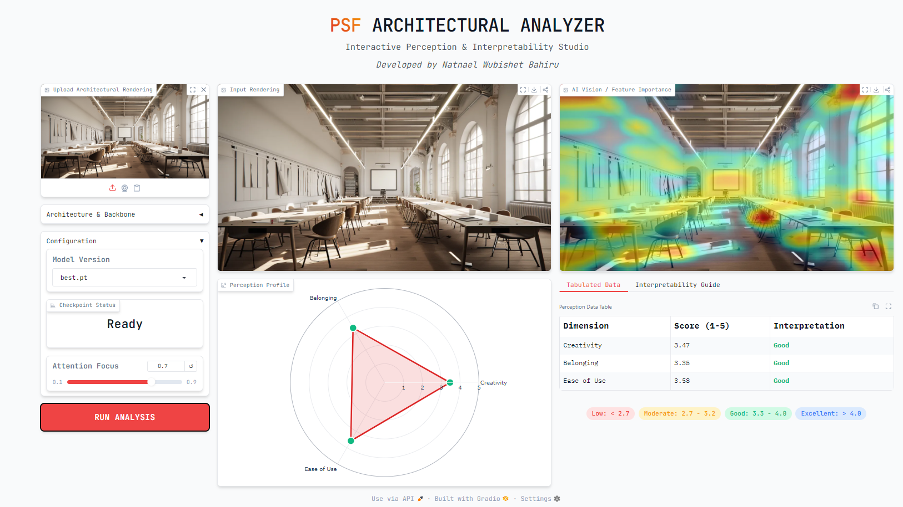

# Image-Based Prediction of Perceived Spatial Functionality in Design Studios Using Deep Learning
   



## Overview

This repository contains the computational framework, dataset architecture, and interactive dashboard developed for the thesis research: **"Image-Based Prediction of Perceived Spatial Functionality in Design Studios Using Deep Learning"** by Natnael Wubishet Bahiru.

The research introduces a methodological approach to quantify the subjective experience of architectural interiors. By leveraging a specialized deep learning regressor built upon the DINOv2 Vision Transformer backbone, this framework approximates human ratings of "Perceived Spatial Functionality" (PSF) within design studio environments. A primary objective of this repository is to identify and analyze the "Perception Gap" between generalized Vision-Language Models (VLMs) and human architectural intuition.

## Repository Architecture

```text
PSF-Architectural-Analyzer/
├── configs/
│   ├── training.yaml                     # Primary scientific configuration (with validation splits)
│   └── ultimate_production_training.yaml # Production configuration (100% data, no splits)
├── dashboard/
│   └── app.py                # Interactive Gradio interface for real-time inference and visualization
├── model/
│   ├── best.pt               # Trained model weights (Note: Managed via Git LFS)
│   ├── dataset.py            # Dataset loading, preprocessing, and augmentation pipelines
│   ├── evaluate.py           # Quantitative evaluation script (generates comparative charts and metrics)
│   ├── inference_gradcam.py  # Qualitative evaluation script (generates batch Attention Rollout heatmaps)
│   ├── model.py              # Core PyTorch model definition (DINOv2 + Regression Head)
│   ├── predict.py            # Bulk inference script for CSV-based predictions
│   └── training_script.py    # Two-phase fine-tuning orchestration script
├── README.md                 # Primary documentation
└── requirements.txt          # Python dependency specifications
```

## Core Methodological Features

- **Self-Supervised Backbone**: Utilizes DINOv2 (ViT-B/14) to extract deep structural and semantic features from architectural renderings without reliance on labeled pre-training.
- **Optimized Architecture**: Implements a standard 768-dimensional CLS projection optimized for generalization across diverse spatial stimuli.
- **Two-Phase Fine-Tuning Orchestration**: Employs a 15-epoch head stabilization phase followed by a 250-epoch deep refinement of the transformer blocks.
- **Rigorous Scientific Validation**: Demonstrates substantial predictive capability on held-out architectural stimuli, achieving an R-squared (R²) of 0.42 and a Mean Absolute Error (MAE) of 0.61.
- **Gradient-Free Interpretability**: Leverages Attention Rollout mechanisms to generate spatial importance heatmaps, enabling qualitative audits of the architectural features influencing the model's perception.
- **Interactive Interpretability Studio**: Provides a real-time analytical interface utilizing Plotly radar profiles and Gradio for immediate spatial assessment.

## Installation and Setup

### Prerequisites

- Python 3.10 or higher
- NVIDIA GPU with CUDA 12.x support (Highly recommended for inference and required for training)

### Environment Configuration

It is recommended to use a virtual environment to manage dependencies:

```bash
python -m venv .venv
source .venv/bin/activate  # On Windows use: .venv\Scripts\activate
pip install -r requirements.txt
```

### Git Large File Storage (LFS)

The trained model weights (`model/best.pt`) exceed standard version control limits (~347 MB). Git LFS must be utilized to track and download this file successfully.

To track this file locally and prepare for repository publishing:
```bash
git lfs install
git lfs track "*.pt"
git add .gitattributes
git add model/best.pt
```

## Usage and Execution

Execute all commands from the root directory of the repository (`PSF-Architectural-Analyzer/`).

### 1. Interactive Studio Interface
Launch the local web dashboard to analyze individual renderings:
```bash
python dashboard/app.py
```

### 2. Model Training
The repository provides two distinct training configurations depending on the objective:

**Option A: Scientific Validation (Default)**
Maintains a 15% validation and 15% test split for rigorous academic evaluation and benchmarking.
```bash
python model/training_script.py --config configs/training.yaml
```

**Option B: Production Deployment**
Utilizes 100% of the dataset, unfreezes deeper transformer layers, and applies heavy augmentation to maximize final model capacity and accuracy.
```bash
python model/training_script.py --config configs/ultimate_production_training.yaml
```

### 3. Quantitative Evaluation
Generate comprehensive evaluation metrics (R², MAE, Pearson r, ICC) and statistical visualizations (Radar charts, Scatter plots, Bland-Altman plots):
```bash
python model/evaluate.py --config configs/training.yaml
```

### 4. Qualitative Interpretability
Generate batch Attention Rollout heatmaps to visualize the spatial regions driving the model's predictions across extreme cases:
```bash
python model/inference_gradcam.py --config configs/training.yaml
```

### 5. Bulk Inference
Generate CSV-based predictions for a directory of unlabelled renderings:
```bash
python model/predict.py --input "path/to/images_directory"
```

## License and Citation

### Dataset
The architectural stimuli dataset utilized to train this model is publicly available on Zenodo. If you use the dataset, please cite it as follows:

> Bahiru, N. W. (2026). *Dataset for: Image-Based Prediction of Perceived Spatial Functionality in Design Studios Using Deep Learning*. Zenodo. https://doi.org/10.5281/zenodo.20351102

### Codebase & Thesis
The source code in this repository is provided under the **MIT License**.

The full thesis manuscript, *"Image-Based Prediction of Perceived Spatial Functionality in Design Studios Using Deep Learning"*, is currently pending publication. Until the official thesis is released, if you utilize this codebase or theoretical framework in your academic work, please cite this GitHub repository alongside the Zenodo dataset above.
